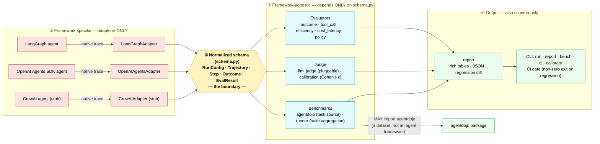

# AgentTrace architecture

AgentTrace has exactly one load-bearing idea: **normalization**. Every framework emits traces in
its own shape; an adapter converts that shape into one common schema at the edge, and **nothing
downstream is allowed to see past it**. Evaluators, the judge, benchmarks, and reporting depend
only on [`schema.py`](../src/agenttrace/schema.py) — they never import or branch on a framework.
Adding a new framework = writing one new adapter, nothing else.

## The pipeline, and the boundary

Everything **right of the normalized schema is framework-agnostic**: it operates only on
`Trajectory` / `EvalResult` and could not name the framework that produced the run if it tried.
Everything **left of the schema is framework-specific** and confined to `adapters/`.

**Legend**

- 🟥 **Red (zone ①)** — framework-specific. The *only* code that knows a framework's native shape.
  Lives exclusively in [`adapters/`](../src/agenttrace/adapters/).
- 🟨 **Yellow (zone ②)** — the boundary: the normalized schema. Every arrow crossing it carries a
  `Trajectory` or `EvalResult`, never a framework object.
- 🟦 **Blue (zone ③)** and 🟩 **green (zone ④)** — framework-agnostic. Verified: **no `import
  langgraph | langchain | agents | crewai` exists anywhere outside `adapters/`.**

## The one documented exception

The **benchmark** layer (`benchmarks/`) may import `agentdojo`, because AgentDojo is a *dataset*,
not an agent framework. Crucially, the benchmark layer still emits only schema-compatible data: it
writes a normalized "benchmark block" into `RunConfig.harness_config`, and the `policy` evaluator
reads *that* — so `evaluators/policy.py` imports no `agentdojo` and stays generic. Any future
benchmark that fills the same block is scored by the same evaluator.

## Why this shape

| Decision | Consequence |
|----------|-------------|
| One schema, enforced at the adapter edge | Evaluators / benchmarks / CI gate are written **once** and work for every framework. |
| New capability = new registered `Adapter` / `Evaluator` subclass | No `if framework == …` branches ever accumulate. |
| Judge + benchmark agent are **pluggable** (injected callable / protocol) | The whole suite + CI run deterministically with **no API key**; real LLMs slot into the same seam. |
| Every run writes a JSON audit record (credentials redacted) | Results are checkable and replayable; `RunConfig.fingerprint()` decides comparability. |

## Proof the boundary holds

Adding the **second** adapter (OpenAI Agents SDK) required **zero changes outside `adapters/`** —
only [`adapters/openai_sdk.py`](../src/agenttrace/adapters/openai_sdk.py) and its test were written.
The schema, all five evaluators, the judge, and the report were untouched, and the *same* evaluators
then scored both agents. The sole real difference between the two frameworks — the OpenAI SDK
exposes per-response token usage, the LLM-free LangGraph fixture does not — surfaced exactly where
it should: as `total_tokens=75` vs `total_tokens=0` in the identical `cost_latency` evaluator, with
no evaluator aware of which framework produced the trajectory.

See [`sample_report.md`](sample_report.md) for the real output of a full run.
